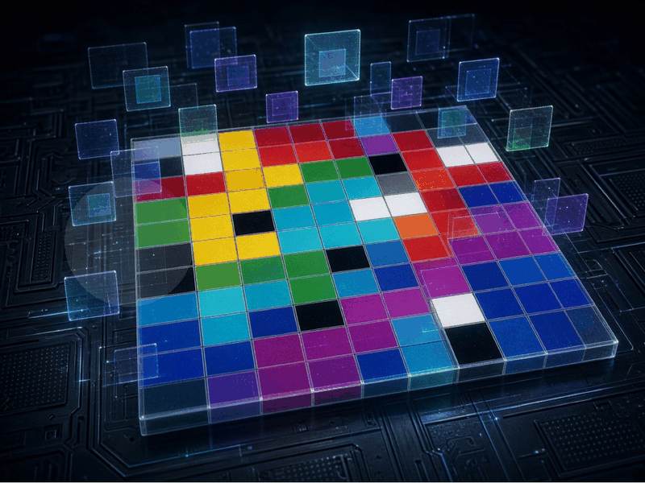
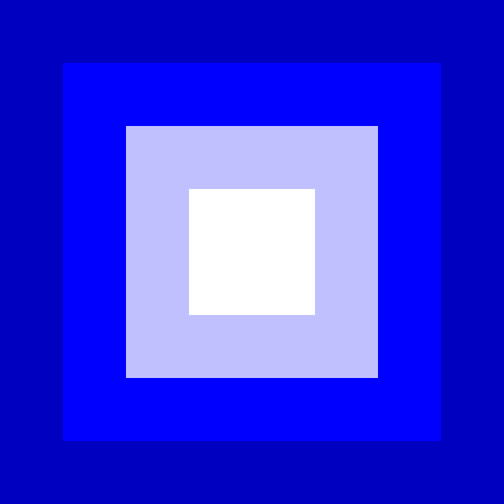
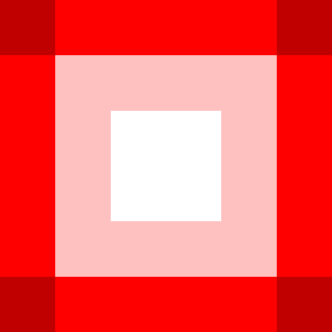

<div align="center">

# 🌌 Holographic Abjad Piet Runtime

**Pure Piet esoteric visual programs**  
*The images are the code. The square is the 3D cryptographic front-end.*

[](https://github.com/AHMADALIPARR/holographic-abjad-piet-runtime)
[](LICENSE)

</div>

---

<div align="center">

## ✨ The Star — Animated Piet Hologram

<p align="center">
  
</p>

*Looping Piet hologram. The grid breathes — colors pulse, the two renders crossfade, the hologram moves. The animation is the runtime walking the square.*

</div>

---

<div align="center">

## Holographic Square — Primary

<p align="center">
  
</p>

*Primary holographic square — 8×8 Piet codels. Outer ring dark (Jalāl / contraction), inner ring light (Jamāl / expansion), center white equilibrium (53 / 106).*

## Secondary — Four Pillars

<p align="center">
  
</p>

*Secondary square — 6×6 Piet codels. Four corner pillars (dark red) framing the center. Red cycle: dark → normal → light.*

## 4×4 Piet Grid

<p align="center">
  
</p>

*Clean 4×4 Piet grid — all 18 canonical Piet colors across hue and lightness cycles.*

## Minimal 3×3 Wafq Allāh

<p align="center">
  
</p>

*Minimal 3×3 Wafq Allāh (constant sum 33) in canonical Piet palette. Values [[8,1,24],[15,11,7],[10,21,2]] mapped to Piet colors. Generate more with `python generate_wafq_piet.py`.*

</div>

---

## Overview

This repository is the visual runtime for the Abjad matrix using **only Piet**.  

Piet programs look like Mondrian paintings. Contiguous color blocks (codels) and hue/lightness cycle transitions drive a stack machine. Black walls and white slides control flow. The holographic square is the front-end that “builds or destroys” (kenoma → pleroma at the bifurcation threshold).

### Core Constants

| Constant | Value | Meaning |
|----------|-------|---------|
| Al-Ḥamīd | 53 | Root name value |
| Mirror dimension | 106 | 53 × 2 |
| Bifurcation threshold | 49 | 7², digit-root of 106 |
| Wafq Allāh 3×3 | 33 | Magic constant |
| Master aggregate | 256 | 16² = Al-Ḥamīd-full + Aḥmad + ʿAlī |
| Jamāl vector | 146 | Expansion |
| Jalāl vector | 110 | Contraction |
| Polarity delta | 36 | One 360° quadrant |
| 16×16 magic | 2056 | n(n²+1)/2 |

**States**  
- Kenoma: `t < 49`  
- Pleroma: `t ≥ 49`

## How to Run the Piet Programs

1. Download any image from `images/` (all are valid PNG Piet programs, plus the animated GIF)
2. Open in a Piet interpreter:
   - [npiet](https://www.bertnase.de/npiet/)
   - Online: https://gabriellesc.github.io/piet/
   - Or any Rust/LLVM Piet runner
3. Set codel size (often auto or 1)
4. The pointer walks the color transitions, pushing Abjad values, computing digit roots, verifying the Wafq, and branching on the bifurcation.

## Source of Truth

Full original Rust formulation with tests: [`src/abjad_matrix.rs`](src/abjad_matrix.rs)

## Generator

```bash
python generate_wafq_piet.py
```

Produces the 3×3 Wafq layout.

---

<div align="center">

**The square is the runtime. The colors are the cryptography. The hologram is the front-end.**

Made with pure Piet.

</div>
